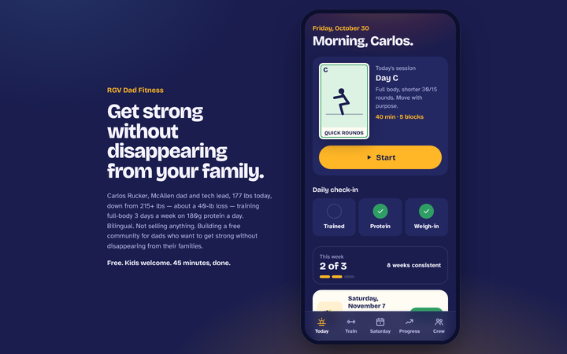
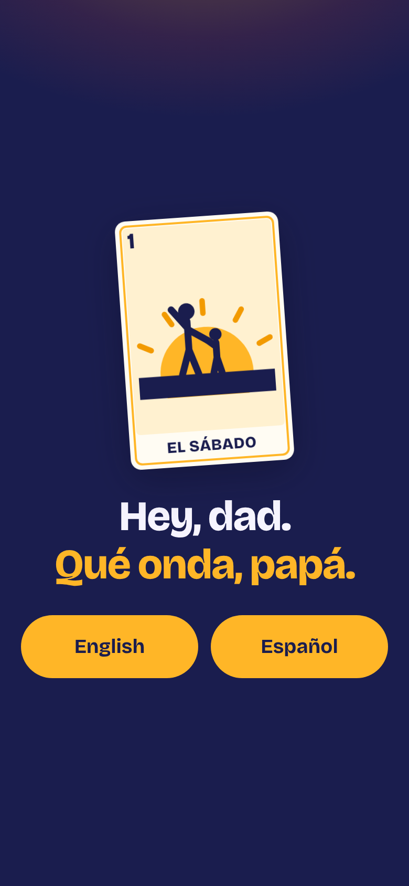
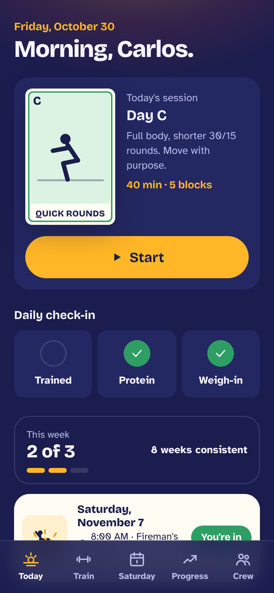
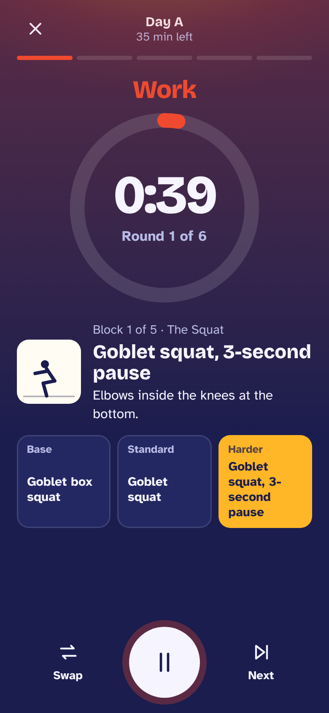
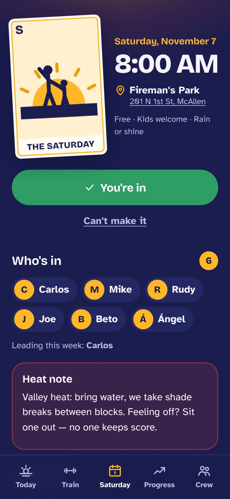
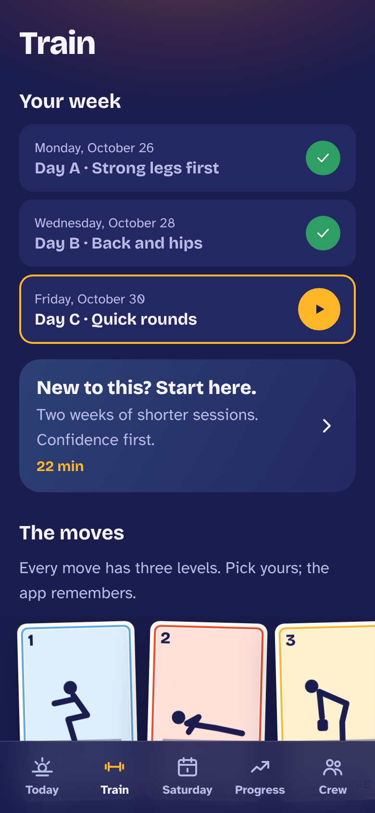
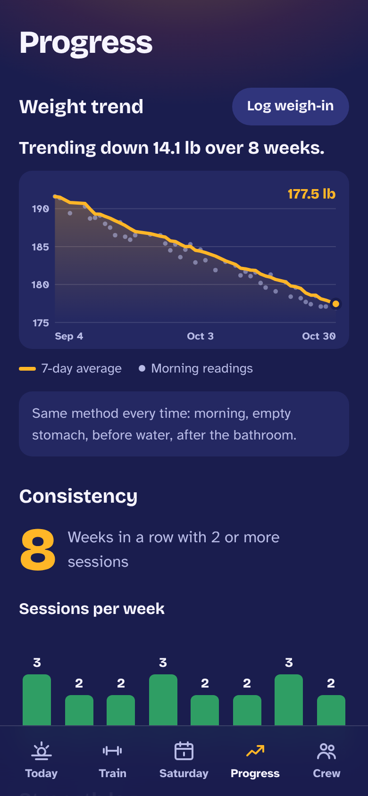
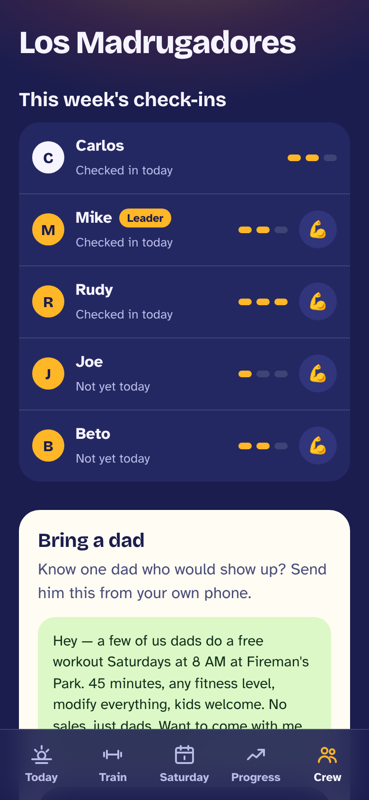
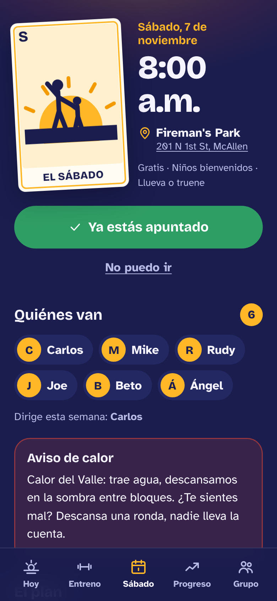

# RGV Dad Fitness

A free, bilingual fitness home base for Rio Grande Valley dads who want to get strong without disappearing from their families.

It runs a real, in-person community — a free Saturday 8 AM workout in a McAllen park — and makes it easier to show up, stay consistent between Saturdays, and bring another dad. The app digitizes the community; it doesn't replace it.



**Try it with sample data:** run it locally and open `/?demo=1` (add `&lang=es` for Spanish, `&sun=1` for sunlight mode).

## Why it exists

The McAllen–Edinburg–Mission metro has one of the highest adult obesity rates in the country, and no dedicated dad-fitness crew. FIT4MOM proves the parent-workout model works locally — for moms. Nobody had built the dad version.

The founder is the credibility: a McAllen dad down about 40 lb, training full-body three days a week, in this heat, with kids, in both languages. Every design decision follows from that.

## Screens

| Language first | Today | Workout player | Saturday |
| --- | --- | --- | --- |
|  |  |  |  |

| Train | Progress | Crew | En español |
| --- | --- | --- | --- |
|  |  |  |  |

## What it does

- **Onboarding in under two minutes, zero typing required.** Language on the first screen, the founder's story as the welcome, then city, equipment, three training days, a plain-language health readiness check (with a "talk to your doctor first" path that gates workouts), and a goal the dad picks. The app never assigns calorie or weight targets.
- **Today.** One session card with a big Start button, or a rest day that says so. A 20-second daily check-in (trained / protein / weigh-in). This week's count and a consistency streak measured in *weeks*, not perfect days. Two missed sessions bring a kind "restart" session, never a broken-streak guilt screen.
- **Workout player.** 45-minute full-body circuits: warm-up, squat / push / hinge / carry / core, finisher. Every move has base / standard / harder levels side by side, plus a no-equipment swap. Interval ring timer with beeps, vibration, and spoken cues in the dad's language; keeps the screen awake; works offline.
- **The Saturday hub.** Date, time and park, one-tap RSVP, who's in (first names only), who's leading, the plan, a heat note for Valley summers, and the closing circle. Leaders get a run-sheet, attendance tap-list, and recap posting.
- **Progress without verdicts.** Morning weigh-ins plotted as dots under a 7-day average line, with the weigh-in protocol on the entry screen. Flat or rising trends get a neutral note, never red alerts. Sessions per week, consistency streak, and a strength log of level and load per move.
- **Crew.** A deliberately thin view of a 3–5 dad crew's week, pre-written encouragement, and a bilingual "bring a dad" invite the user sends from his own phone. The app never messages anyone on a user's behalf.
- **Around the Valley.** An admin-curated directory of local groups and gyms. Entries flagged "confirm first" in research stay hidden until the organizer re-checks them and stamps a date.
- **Organizer tools.** Edit the Saturday session, manage the crew, review the directory, and see pilot metrics that favor consistency over downloads.

## Design

The one loud element is the **Lotería card**. Sessions and movement patterns are drawn as cards from the game every Valley kitchen table knows — card number, picture, title banner (*La Sentadilla, El Empuje, El Peso Muerto, La Carga, La Plancha, El Sábado*). The pictures are two-pose line figures that cross-fade to show the movement itself, so the "demo" works offline and costs no data.

Everything around the cards stays quiet:

- **Palette:** pre-dawn indigo (`#1A1D4E`) with a mango sunrise (`#FFB627`) — the 8 AM park — plus chile for effort, nopal for done, and cielo for rest.
- **Type:** Bricolage Grotesque for headlines; Atkinson Hyperlegible for everything you read mid-workout, chosen for legibility in full sun.
- **Sunlight mode:** a maximum-contrast light theme for a phone on a park bench.
- Large tap targets, keyboard focus, and reduced-motion support throughout.

## Principles it holds to

Free, no paywalls. Bilingual from the start — every string is written natively in English and Spanish, not machine-translated. Kids are always welcome and never users. 45 minutes, done. Trend over single readings. Consistency over intensity, and no weight-loss leaderboards. Health data stays on the phone: no analytics, no third-party SDKs, no external requests (fonts are bundled), and the user can export or delete everything in-app.

## Tech

- React 18 + TypeScript + Vite, hand-written CSS, no UI framework.
- Installable PWA with a service worker; the workout player and Saturday screens work offline after the first visit.
- All UI text externalized in [`src/strings.ts`](src/strings.ts); content entities carry `en`/`es` fields.
- Data model follows the handoff spec (users, programs, templates, exercises, sessions, RSVPs, logs, check-ins, weigh-ins, crews, directory, recaps), stored on-device for the pilot. Derived views (7-day average, streaks, weekly counts) are computed, never stored.
- Dates are America/Chicago calendar days, spelled out ("Saturday, November 7").
- About 73 KB of JavaScript gzipped.

```bash
npm install
npm run dev        # http://localhost:5173/?demo=1
npm run build      # production build in dist/
```

A GitHub Actions workflow in `.github/workflows/pages.yml` deploys `main` to GitHub Pages once Pages is enabled for the repo (Settings → Pages → Source: GitHub Actions).

## What's next

v2, in priority order: Apple Health / Health Connect sync, a Challenge-RGV season mode for the January partner season, push reminders, a session-plan builder so any regular can lead a Saturday, and a Sunday ruck club. A shared backend replaces on-device storage when the crew grows past the pilot.

---

*This app supports general fitness habits. It is not medical advice and does not diagnose or treat anything.*
